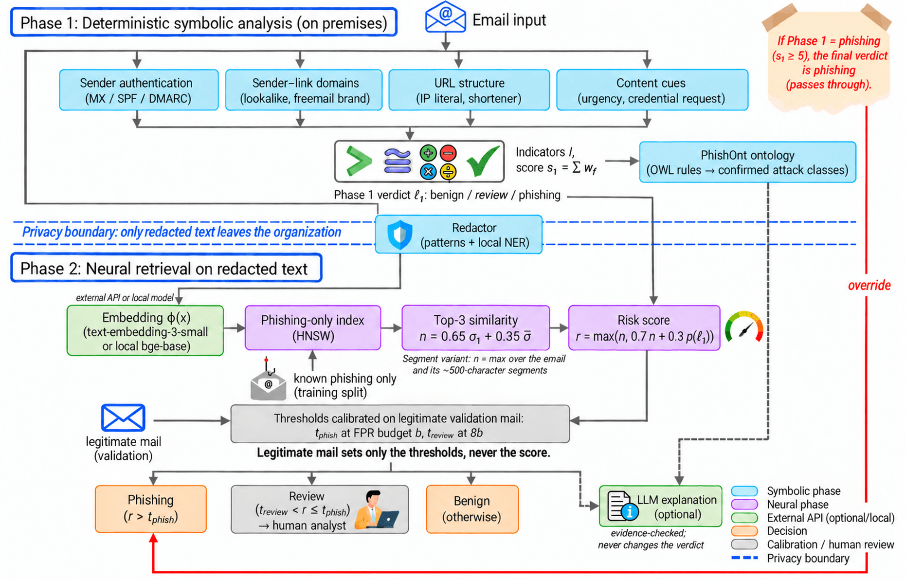

<p align="center">
  
</p>

# CyberCane: Privacy-Bounded Neuro-Symbolic Phishing Detection under Distribution Shift

> **Calibrated for a 1% false-positive budget on older public mail, trained detectors realize 20–23% FPR on 2025 email. CyberCane realizes 5.4% at 86% recall, screening each email locally in 0.20 s.**

Organizations usually calibrate phishing detectors on public corpora, because privacy rules make their own labeled legitimate mail hard to collect. CyberCane scores an email only by its similarity to known phishing in a redacted, training-only index, plus deterministic rules, and calibrates its verdicts to an explicit false-positive budget. Because legitimate mail never enters the score, only the threshold depends on the calibration source.

Paper (preprint): https://arxiv.org/abs/2604.23563

> **Code for the current paper** is on the [`calibration-study`](https://github.com/sbhakim/Cybercane/tree/calibration-study) branch. Earlier results in this repository used a random split of DataPhish 2025, which the paper shows leaks 96% of its test set; use the group-aware splits on that branch instead.

---

## Architecture

<p align="center">
  
</p>

- **Phase 1 (on premises, raw email):** weighted rules for sender authentication (MX, SPF, DMARC), lookalike domains, suspicious URLs, urgency and credential requests produce indicators, a score and a rule verdict.
- **PhishOnt:** an OWL ontology asserts attack classes only when all of their premises hold, and otherwise only suggests them.
- **Privacy boundary:** a single redaction function masks personal identifiers before any text leaves the machine.
- **Phase 2 (retrieval and risk):** the redacted email is embedded and compared with a phishing-only HNSW index; similarity and the rule score combine into a risk score with thresholds calibrated to an FPR budget.
- **Explanations:** an LLM writes tagged explanations, and every claim is checked against the stored evidence. The verdict never depends on this text.

---

## Key Results

All experiments were preregistered in a dated log before they were run. Means over five seeds with cluster-bootstrap 95% CIs; full tables are in the paper.

**Benign-distribution shift** (calibrated on SpamAssassin 2002, deployed on DataPhish 2025, 1% FPR budget):

| Method | Realized FPR | Recall |
|---|---|---|
| TF-IDF logistic regression | 22.9% | 98.2% |
| Embedding logistic regression | 20.2% | 99.7% |
| Two-class kNN | 22.5% | 100.0% |
| **CyberCane** | **5.4%** | **86.4%** |
| Zero-shot LLM (gpt-oss-120b) | 0.7% | 56.4% |

- Trained baselines overrun the budget **9–94×** across three calibration sources; CyberCane reduces the overrun **2.7–6.1×**. Baselines using the same embeddings fail equally, so the decision rule, not the embedding model, is the cause.
- The failure is **calibration transfer, not ranking**: with thresholds chosen on the deployment mail, the same classifiers separate phishing from legitimate mail well.
- **Segment-level scoring** (the email's most phishing-like part) lowers the realized FPR a further 1.2–2.7× and withstands benign padding.
- **Cost:** 0.20 s per email with a local embedder and no text sent out; a zero-shot Llama 3.3 70B ranks better at strict FPR but is 14–24× slower and must receive each email.
- **LLM rewriting** does not evade embedding-based detectors; the shift in legitimate mail drives the overrun.
- **Redaction:** six structured identifier types are removed in every planted case; person names are the weak point (94.4% recall after a cue, 79.8% without one).

---

## Human Annotation

Explanation and redaction audits were labeled in our [annotation app](https://cybercane-annotations.web.app); [demo mode](https://cybercane-annotations.web.app/?demo) needs no sign-in.

---

## Quick Start

```bash
git clone https://github.com/sbhakim/Cybercane.git && cd Cybercane
cp .env.example .env          # add OPENAI_API_KEY for Phase 2 and explanations
docker compose up --build
# Web UI: http://localhost:3000 | API docs: http://localhost:8000/docs
```

| Endpoint | Description |
|---|---|
| `GET /health` | Service liveness check |
| `POST /scan` | Phase 1 rules only (no API key needed) |
| `POST /ai/analyze` | Full pipeline with a checked explanation |

---

## Reproducing the Paper

On the [`calibration-study`](https://github.com/sbhakim/Cybercane/tree/calibration-study) branch, from the repository root:

```bash
pip install -r api/requirements.txt
PYTHONPATH=api python -m app.evaluation.build_splits_v2 --seeds 42 1 2 3 4      # group-aware splits
PYTHONPATH=api python -m app.evaluation.embed_cache_v2 --stage sanitize          # redaction
PYTHONPATH=api python -m app.evaluation.embed_cache_v2 --stage embed --model openai:text-embedding-3-small
PYTHONPATH=api python -m app.evaluation.replicate_c1_decontam                    # main shift result
PYTHONPATH=api python -m app.evaluation.r2_benign_shift                          # three calibration sources
```

Further experiments (style shift, padding, local embedder, LLM comparators, planted-identifier audit, annotation scoring) are in `api/app/evaluation/`, each with its usage line at the top of the file. Public corpora: Nazario, SpamAssassin, CEAS 2008, Ling-Spam and DataPhish 2025.

---

## Research Lineage

This repository extends the prototype at [UMBC Hackathon](https://github.com/pawelsloboda5/UMBC-hackathon) into a neuro-symbolic research pipeline with ontology reasoning, a privacy boundary and preregistered evaluation.

---

## Citation

```bibtex
@article{hakim2026cybercane,
  author        = {S. B. Hakim and A. Afzal and Q. Zhao and V. Majmundar and P. Sloboda and H. H. Song},
  title         = {{CyberCane}: A Privacy-Bounded Neuro-Symbolic Retrieval Framework for Phishing Detection under Distribution Shift},
  journal       = {arXiv preprint arXiv:2604.23563},
  year          = {2026},
  url           = {https://arxiv.org/abs/2604.23563},
  primaryclass  = {cs.CR}
}
```

---

For questions or collaboration, open an issue or reach out via email: `safayat [dot] b [dot] hakim [at] gmail [dot] com`
